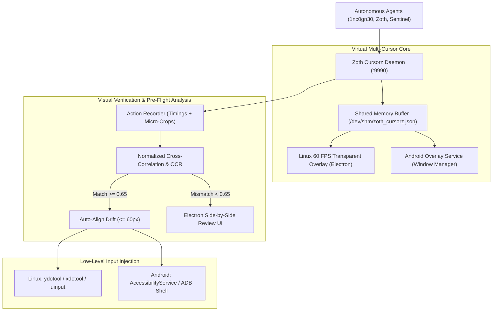

# ⚡ Zoth Cursorz — Sovereign Multi-Agent Virtual Cursor Engine & Workflow Trainer

> **Concurrent Virtual Pointers, 3D Dithered Braille Hologram Trails, Drift Pre-Analysis & Human-like Input Automation for Linux and Android.**

[](https://opensource.org/licenses/MIT)
[](#)
[](#)

---

## ✦ Overview

Traditional computer-use models force AI agents to serialize all desktop interactions through a single hardware mouse cursor. **Zoth Cursorz** revolutionizes this paradigm by introducing:
1. **Multi-Agent Virtual Cursor Engine**: Spawns up to 16 concurrent virtual agent pointers across multi-monitor setups (dual 1080p, 4K, ultrawide).
2. **3D Dithered Braille Hologram Lattice Trails**: Visualizes agent trajectories using ordered Bayer dither mathematics and Unicode U+2800 Braille matrices (`⢀⠠⠐⠈⢄⡄⠤⠶⣶⣾⣿`).
3. **Pixel Character Companions**: Crisp, dithered 1nc0gn30 pixel-art companions floating alongside pointers with procedural breathing and telemetry auras.
4. **Draggable & Clickable Context Menu**: Full pointer interaction with drag repositioning and a context popover providing OCR inspection, click injection, trajectory gliding, and task assignment.
5. **Interactive Training & Visual Pre-Analysis**: Records mouse paths, timing, and clicks with automatic landmark micro-crops (`step_XXX_landmark.png`) and OCR context. During playback, pre-flight CV checks auto-align drift or pause for side-by-side discrepancy review if layouts change.
6. **Dual Linux & Android Support**:
   - **Linux Desktop**: Direct Wayland (`ydotool` / `grim`) and X11 (`xdotool` / `spectacle`) injection.
   - **Android Subsystem**: Native standalone APK with foreground overlay service (`TYPE_APPLICATION_OVERLAY`), Accessibility Service gesture injection (`dispatchGesture` tap and swipe), and ADB host bridge.

---

## ✦ Visual Architecture



---

## ✦ Installation & Setup

### Linux Desktop (Wayland / X11)
```bash
# Clone repository
git clone https://github.com/1nc0gn30/zoth-cursorz.git ~/NullAITech/zoth-cursorz
cd ~/NullAITech/zoth-cursorz

# Binaries are pre-symlinked to /usr/local/bin/zoth-cursorz and ~/.local/bin/zoth-cursorz
zoth-cursorz status
```

### Android Subsystem (APK)
Build the standalone verified APK:
```bash
zoth-cursorz android build
# Installs directly to connected phone or emulator:
zoth-cursorz android install
```

---

## ✦ CLI & Subcommand Reference

### Virtual Cursor Coordination
```bash
# List all active agent cursors
zoth-cursorz list

# Spawn custom virtual cursor
zoth-cursorz spawn artisan "#a855f7" 1200 450

# Smoothly glide cursor with Braille hologram lattice trail
zoth-cursorz move 1nc0gn30 1920 540 "Analyzing buffer"

# Dispatch click
zoth-cursorz click 1nc0gn30 left

# Launch transparent multi-cursor overlay
zoth-cursorz overlay

# Launch multi-agent desktop control dashboard
zoth-cursorz dashboard
```

### Low-Level Computer-Use
```bash
# Direct tap / click
zoth-cursorz tap 960 540

# Gesture swipe (Linux drag or Android touch swipe)
zoth-cursorz swipe 400 800 400 200 300

# Type text buffer
zoth-cursorz type "echo 'NullAI Sovereign Platform'"

# Dispatch hardware key event
zoth-cursorz key Return
```

### Workflow Training & Visual Replay
```bash
# 1. Start recording a workflow preset
zoth-cursorz train start login_pipeline

# 2. Record clicks with automatic landmark crops
zoth-cursorz train click left

# 3. Finalize preset
zoth-cursorz train stop

# 4. Replay with pre-flight visual safety checks
zoth-cursorz run login_pipeline
```

---

## ✦ REST API Specification (Port `:9990`)

| Endpoint | Method | Payload / Parameters | Description |
|---|---|---|---|
| `/api/health` | `GET` | None | Returns daemon status and active cursor count |
| `/api/cursors` | `GET` | None | Returns array of all active agent cursor objects |
| `/api/cursors/spawn` | `POST` | `{"agent_id", "name", "color", "icon", "x", "y"}` | Registers a new virtual pointer |
| `/api/cursors/move` | `POST` | `{"agent_id", "x", "y", "action_text", "execute_hardware"}` | Updates pointer position and trail |
| `/api/cursors/click` | `POST` | `{"agent_id", "click_type", "execute_hardware"}` | Spawns ripple and Braille particle burst |
| `/api/action` | `POST` | `{"action": "click\|move\|type\|key\|swipe", ...}` | Dispatches human-like input injection |
| `/api/screenshot` | `GET` | None | Captures full desktop/Android screen buffer |

---

## ✦ Sovereign Attribution & Open-Access Guarantee

- **100% Free & Open-Access**: Zero paywalls, zero license checks, zero frosted-glass barriers.
- **Engineered by Neal Frazier Tech** ([@1nc0gn30](https://github.com/1nc0gn30)) • **NullAI Platform** ([nullai.tech](https://nullai.tech)).
- **Buy Us a Coffee (Support)**:
  - Stripe: `https://buy.stripe.com/3cIfZg27PdKo2D64Ocfw40X`
  - Solana Tip: `GG2eQbVh8ut1BK6j1A2tz7pSySdLpD38BgyEhGcxdXoK`
